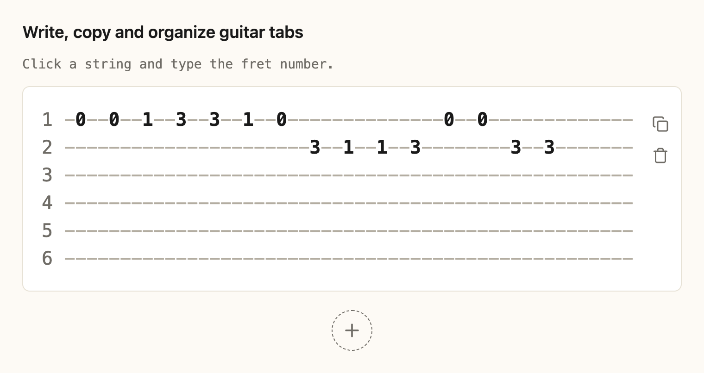
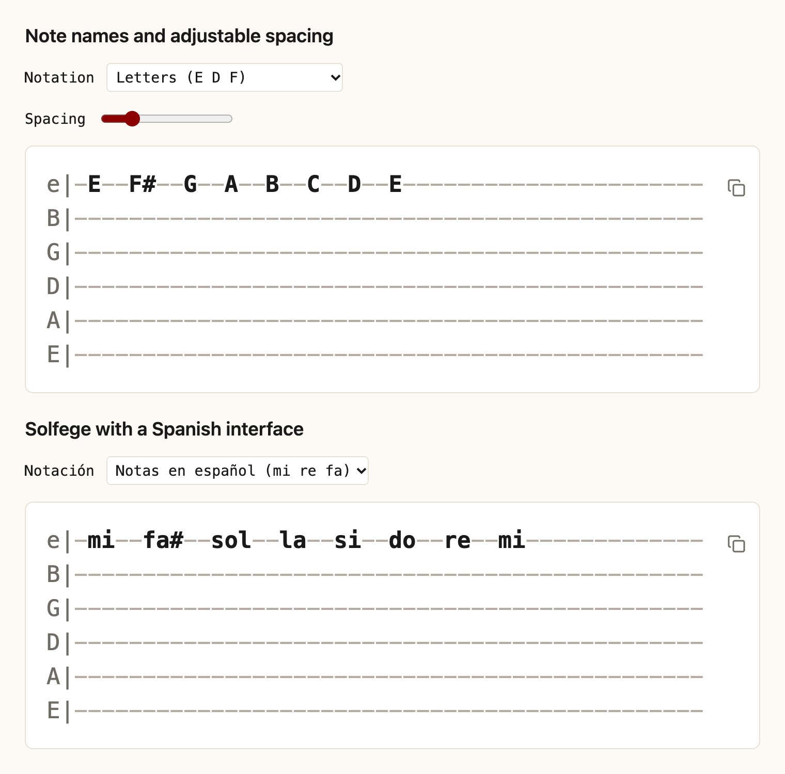
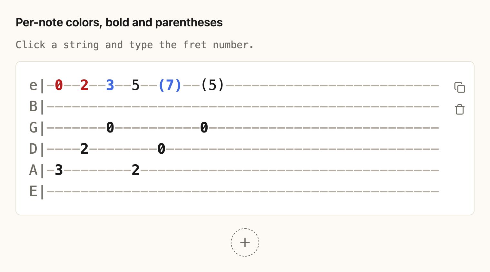
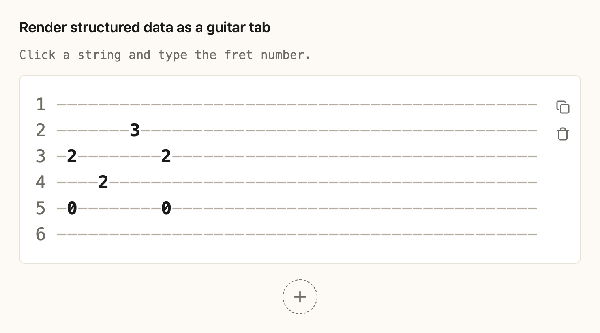

# ascii-tabs

A zero-dependency web component for editing and displaying guitar tablature, with plain ASCII import and export.

**▶ [Try the live demo](https://libasoles.github.io/ascii-tabs/)**: every feature, editable, in your browser.

## Install

`ascii-tabs` is published on npm as a single ES module with no dependencies. It defines the `<ascii-tabs>` custom element when imported, so it works in any framework or in plain HTML.

```sh
npm install ascii-tabs
```

```js
import 'ascii-tabs';
// or, to also use the helpers:
import { parse, format } from 'ascii-tabs';
```

```html
<ascii-tabs></ascii-tabs>
```

No bundler? Load it from a CDN instead, see [Usage](#usage). Full documentation and a live, editable demo: **https://libasoles.github.io/ascii-tabs/**

## See it in action

### Edit and organize tabs

Click a string and type a fret. Navigate with the keyboard, select and move groups of notes, and copy tabs as ASCII. Each Sheet has copy and delete controls, with an add button below.

<a href="https://libasoles.github.io/ascii-tabs/">
  <picture>
    <source media="(prefers-color-scheme: dark)" srcset="docs/img/example-dark.png">
    
  </picture>
</a>

### Switch notation and spacing

Show frets, letter names or solfege, and adjust spacing with optional built-in controls. Interface language and string labels are configurable independently.



### Style individual notes

Highlight a melody with per-note colors and bold text, and put notes in parentheses. The screenshot below uses structured note data in the same editor.



Design notes: [spec](docs/spec-v0.1.md), [glossary](GLOSSARY.md), [ADRs](docs/adr). `tablatura.html` is the original standalone editor this library grew from.

## Usage

```html
<script type="module" src="https://cdn.jsdelivr.net/gh/libasoles/ascii-tabs@0.10.3/ascii-tabs.js"></script>

<ascii-tabs></ascii-tabs>
```

A bare `<ascii-tabs>` is editable: a hint, one Sheet per Tab with copy and delete buttons, and an add button. Click a string and type the fret number (0–24); move with the arrow keys, Enter and Tab. Press Cmd+Right Arrow or Alt+Right Arrow to copy all six strings of the current column into the next column, replacing its contents, and move the cursor there. Press Cmd+0 or Alt+0 to fill only the empty cells of the current column with zeros, keeping existing frets and the cursor in place.

Drag from an empty cell or a blank area of a Sheet to select notes inside a rectangle. Drag any selected note to move the group, keeping its relative columns and strings; occupied destination cells are replaced. Cmd+Right Arrow or Alt+Right Arrow duplicates the selected group immediately after its last column and selects the duplicate. Cmd/Ctrl+C or the Sheet's copy button copies the selection as ASCII; Cmd/Ctrl+V pastes ASCII at the current column, preserving string positions. Delete or Backspace removes the selected notes, and Escape clears the selection.

## Initial value

Pass the content as data through the `value` property. This is the preferred way to fill the element: no parsing, nothing ambiguous, and it is the same shape `value` and `change` give back.

`value` is `(number|{ fret: number|null, color?: string, bold?: boolean, parenthesized?: boolean }|null)[][][]`: an array of Tabs, each an array of Columns, each Column 6 entries from String 1 to String 6, a Fret (0–24) or `null` for an empty String. A note with `parenthesized: true` is displayed and copied in parentheses; `fret: null` is allowed for an empty pair.

```html
<ascii-tabs id="song"></ascii-tabs>
<script>
  song.value = [
    [ // one Tab
      [null, null, 2, null, 0, null],
      [null, null, null, 2, null, null],
      [null, 3, null, null, null, null],
      [null, null, 2, null, 0, null],
    ],
  ];
</script>
```

The component renders that data as:



`value` can be set before or after the element upgrades. Read it back the same way; every edit fires `change`:

```js
song.addEventListener('change', e => console.log(e.detail.value));
```

`change` fires immediately when a cell's value changes, including each accepted digit
(desktop and mobile), Backspace, Delete, Escape, parentheses and bold toggles.
For a single-cell edit, `detail.note` identifies the edited cell and its new value:

```js
song.addEventListener('change', ({ detail: { value, note } }) => {
  save(value); // All Tabs, in the same format as song.value.
  if (note) {
    const { tabIndex, columnIndex, stringIndex, value: editedNote } = note;
    preview(editedNote, { tabIndex, columnIndex, stringIndex });
  }
});

song.addEventListener('cellblur', ({ detail: { value, note } }) => {
  // Same payload when leaving a cell, including an untouched cell.
  commit(value, note);
});
```

Indices are zero-based; `stringIndex: 0` is String 1. `note.value` is a number,
a note object (including its styles), or `null` after clearing the cell. Both
`detail.value` and `note.value` are independent copies. Multi-cell operations
(paste, moves, duplication, selection edits) and Tab additions/removals emit
`change` with `note: null`. `cellblur` bubbles when keyboard or pointer navigation
moves to another cell, or when the editor loses focus; clicking the same cell
does not emit it. These are DOM events: register callbacks with `addEventListener`.

Setting `value` does not fire `change`. The component is uncontrolled by default; for the controlled pattern, keep the Tabs in your own state, update it on `change` and write `value` back when the state changes elsewhere:

```js
let state = [[]];
song.value = state;
song.addEventListener('change', e => { state = e.detail.value; save(state); });
function load(next) { state = next; song.value = state; }
```

### Column annotations

Set `annotations` to an array per Tab of `{ column, text }` or `{ column, html, text? }` entries. `column` is
the zero-based logical Column index in `value`, independent of Spacing and Staff
breaks. No spaces are needed to align text:

```js
song.labels = 'notes';
song.setDocument({
  value: [[
    [null, null, null, null, null, null],
    [1, 3, 2, 0, null, null],
    [1, 3, 2, 3, null, null],
    [1, 3, 2, null, 0, null],
  ]],
  annotations: [[
    { column: 0, text: 'RE MENOR' },
    { column: 1, text: 'Dm*' },
    { column: 2, text: 'Dm/F*' },
    { column: 3, text: 'Dm/A' },
  ]],
});
// Update text independently, keeping the editing cursor:
song.annotations = [[{ column: 1, text: 'Dm' }]];
```

Changing the Spacing slider, notation, labels, font or available width keeps each
Annotation aligned with its Column, including when it moves to another Staff.
In ASCII layout the text starts at the Column's Fret position; with `columnLayout`
it starts at the supplied center. Long text wraps within the remaining Staff
width. Overlapping annotations occupy separate lanes above the Strings, and each
Staff reserves their full height. Explicit newlines are supported, duplicate
anchors stack. `text` displays HTML characters literally; `html` renders markup:

```js
song.annotations = [[
  { column: 1, html: '<strong>Dm</strong><sup>*</sup><br><small>Intro</small>' },
  { column: 2, html: '<em>Dm/F</em>', text: 'Dm/F' },
]];
```

When both fields are supplied, `html` controls the display and `text` is the ASCII
fallback. Without a fallback, browser copy/export extracts text from HTML,
decoding entities and preserving `<br>` and common block breaks. `format()` outside
a browser requires `text` for HTML annotations and throws a `TypeError` if it is
missing. HTML is inserted as supplied; pass trusted or sanitized markup. Normal
flow HTML participates in collision measurement, including later size changes
such as loaded images. Arbitrary positioned content can escape that flow.

Column indices must be nonnegative integers within the corresponding Tab,
including explicitly supplied empty Columns. Invalid annotations throw a
`TypeError` before changing state. Empty display content is hidden; `null` or `[]` clears all
annotations. Assignment and retrieval copy every entry. Entries are sorted by
Column, preserving the order of duplicate anchors. Annotations on trailing empty
Columns keep those Columns in `value` and ASCII output.

Setting `value` preserves annotations and requires their anchors to remain valid.
Use `setDocument({ value, annotations, columnLayout })` to update them atomically;
omitting `annotations` from `setDocument` clears them. Properties can be assigned
before upgrade, with `value` supplied first. Annotation updates do not emit
`change`. Annotations are separate from note data and built-in note storage;
persist them in consumer state. Deleting a Tab removes its annotations. Editing,
dragging and duplicating Frets leave annotations attached to their Columns.

#### Annotation width

`annotation-fit` (property `annotationFit`) decides what an Annotation does to
the Columns around it, in editable and `readonly` Tabs alike:

| Value | Behavior |
| --- | --- |
| `widen` (default) | The Annotation's Column grows to hold its text plus one space, so the next Column starts after it, even when that Column has notes and no Annotation. |
| `overflow` | Columns keep the width of their Frets; long text crosses into the next Column. Overlapping Annotations still stack in separate lanes. |
| `stagger` | Annotations alternate between two rows, so each can span about two Columns. Only when two Annotations on the same row would touch does the gap between them grow. |

```html
<ascii-tabs annotations-editable annotation-fit="stagger"></ascii-tabs>
```

Widths use the text (or `text` fallback of an `html` Annotation), measured in
characters, and are recalculated whenever Annotations, Spacing, notation or the
available width change. Text longer than a Staff wraps inside it. The setting does
nothing with `columnLayout`, which keeps its explicit geometry. Copy
uses the same widths and rows, and a Column grows when an edit is committed. `format(tab, { annotations, annotationFit })` takes
the same option and defaults to `'overflow'`, so existing output does not change.

Whole-Tab copy includes annotations, calculating ASCII offsets from the selected
Spacing and notation. `format(tab, { annotations: [{ column: 1, text: 'Dm' }] })`
uses the same anchors; colliding text occupies separate lines. Copying selected
notes keeps the usual six-String ASCII. ASCII import/paste still accepts numeric
tablature; remove annotation lines before parsing copied text.

### Editing annotations and titles

Enable either interaction independently (both default to off):

```html
<ascii-tabs annotations-editable titles-editable></ascii-tabs>
```

The matching properties are `annotationsEditable` and `titlesEditable` (booleans).
Hover a Column to reveal a short horizontal bar above its Strings; click in that
upper strip to write an annotation. Clicking the Strings still edits Frets. Click
an existing annotation to edit it. The first annotation at an anchor is edited
from its strip; stacked annotations can each be clicked separately.

Hover the empty space immediately above a Sheet's upper-left corner to reveal
the same indicator for its title. Titles sit outside the card. Both targets also
work by touch or keyboard: Tab to the target and press Enter or Space. The editor
has no surrounding border, just a thin bottom border. Enter or blur saves,
Escape cancels, and Shift+Enter inserts a newline. Saving empty text removes the
annotation or clears the title. Typed text is literal; editing an HTML annotation
replaces that entry with plain text only when its text changes. Cancelling or
saving unchanged text preserves the HTML.

`tabTitles` is an array of strings, one per Tab; missing entries are empty titles.
Assign `null` or `[]` to clear titles. Titles display even when editing is disabled
or `readonly` is set. `readonly` disables both interactions. `value` assignments
preserve titles; `setDocument({ value, annotations, columnLayout, tabTitles })`
updates the whole document atomically and clears titles when omitted. Removing a
Tab removes its title; adding a Tab starts with an empty title. Titles are display
metadata and are not included in ASCII copy/export.

```js
song.tabTitles = ['Estudio en re menor'];
song.addEventListener('annotationchange', ({ detail }) => {
  // { index: Tab index, column: Column index, annotations: all Tabs' annotations }
  saveAnnotations(detail.annotations);
});
song.addEventListener('titlechange', ({ detail }) => {
  // { index: Tab index, title: updated text, tabTitles: all Tabs' titles }
  saveTitles(detail.tabTitles);
});
```

These events bubble and fire only for user edits that change content. Programmatic
assignments are silent. They do not emit the component's note `change` event.
Persist annotations and titles in consumer state; built-in storage contains notes.
Annotating an empty visual Column makes it a logical Column in `value` so its
anchor stays valid. Programmatic updates to the document or metadata, disabling
editing, removing a Tab, and disconnecting cancel any open text editor.

### Aligning with a score

Use external geometry when a score renderer owns horizontal spacing. Update the
content and geometry together, especially when the number of Columns changes:

```js
song.setDocument({
  value: [[
    [5, 7, null, null, null, null],
    [null, null, null, null, 0, null],
    [12, null, null, null, null, null],
    [null, null, null, null, null, null],
  ]],
  columnLayout: [{ width: 640, positions: [84.5, 132, 201.25, 290] }],
});
```

`columnLayout` has one `{ width, positions }` entry per Tab. Each `positions[c]`
is the center of Column `c` in CSS pixels from the left edge of the String area
(`.ascii-tabs-area`). `width` excludes labels, Sheet padding and tools. Align that
area's origin with the score and translate score coordinates into CSS pixels.
Labels occupy their own gutter. Frets, note names and parentheses are centered
independently of their text width. Set `--ascii-tabs-fret-background` to match the
surface behind the Frets; it defaults to `--ascii-tabs-sheet`.

Widths must be finite and positive; positions must be finite, strictly increasing,
within `[0, width]`, and match the logical Column count, including trailing empty
Columns. A Tab with zero Columns uses `positions: []` and still shows six Strings.
Invalid geometry or mismatched content throws a descriptive `TypeError` before
changing state. Geometry is copied on assignment and retrieval.

Each Tab stays in one Staff, with horizontal scrolling when needed and no automatic
padding or wrapping. `value` and `change.detail.value` preserve all Columns.
Editing, mobile input, selection and dragging retain their logical indices.
Clicks and drop targets choose the nearest center within the String area; exact
ties choose the earlier Column. Moving or duplicating Frets within existing
Columns is allowed. Paste, duplication and group moves that exceed the available
Columns are rejected in full. Navigation stops at the first/last Column; deleting
Frets leaves their Columns in place. Add/delete Tab buttons are disabled, and
`addTab()`/`removeTab()` do nothing: structure belongs to the consumer.

Assign `song.columnLayout` to reposition existing Columns without resetting the
cursor or typing. Assigning `song.value` while geometry is active requires the same
Tab/Column counts; use `setDocument({ value, columnLayout })` to change both
atomically. Programmatic assignments do not emit `change`. Properties may also be
assigned before custom-element upgrade (supply both `value` and `columnLayout`).
Built-in storage is suspended while external geometry is active: it neither loads
nor overwrites the ASCII store. The consumer owns persistence.

```js
song.addEventListener('layoutoverflow', ({ detail }) => {
  // { index, width, collisions }
  // Recalculate score spacing, then provide new positions and width.
  console.log(detail);
});
```

`layoutoverflow` bubbles after rendering when displayed Frets overlap on a String
or extend past the area's edges. Each collision has a zero-based `string`,
`columns` indices and an `overlap` in CSS pixels; edge collisions also have
`edge: 'left' | 'right'`. Identical reports are suppressed until geometry or
collisions change. Centers never move automatically. Increasing only `width`
does not separate existing centers: recalculate positions too.

Set `song.columnLayout = null` to restore ASCII layout, wrapping, storage and
editing. `setDocument({ value })` also selects ASCII layout. Copy still uses
`format()` and exports ordinary ASCII with the chosen Spacing and notation;
pixel positions and trailing empty Columns are not preserved in copied text.
Geometry is never stored inside `Tab[]`.

### Per-note colors and bold

Use an object instead of a number to give a note its own CSS color:

```js
song.value = [[
  [{ fret: 3, color: '#e63946' }, null, null, null, null, null],
  [5, { fret: 2, color: 'royalblue' }, null, null, null, null],
]];
```

Numbers still use the default color. Objects require a valid `fret` (0–24); omitted or invalid colors use the default. Colors are preserved in `value`, `change`, storage, edits, moves and duplicates. Returned objects are independent copies. Color applies only to the note, including while focused; string dashes keep their theme color. CSS variables such as `var(--melody-color)` work too.

Set `bold: true` for bold text or `bold: false` for normal weight. Omit `bold` to keep the existing default (bold). You can combine it with `color`:

```js
song.value = [[
  [{ fret: 3, bold: true, color: '#b91c1c' }, null, null, null, null, null],
  [{ fret: 5, bold: false }, null, null, null, null, null],
]];
```

Press `b` to toggle each selected note's bold state, or the current cell's note when there is no selection. Empty cells stay empty. Notes without an explicit `bold` value start bold, so the first press makes them normal weight.

`bold` accepts booleans only and follows the note through edits, moves, duplication, `value`, `change` and storage. Copying as ASCII discards font weight.

Colors are available through structured data only. ASCII input has no color information, and copying or calling `format` exports plain text without colors.

Type `(` (Shift plus the opening-parenthesis key for your keyboard layout) in a cell to wrap its note in parentheses. An empty cell gets an empty pair with the caret inside, ready for a fret number. Repeating the shortcut keeps a single pair. Parentheses survive storage, ASCII copy/paste, and notation changes.

To erase a parenthesized note, press Delete/Supr: this clears the entire cell, including the parentheses. Backspace removes digits inside the parentheses and leaves `()` when the last digit is erased. Escape restores the cell's value before the current edit, so it also undoes parentheses just added. There is currently no shortcut to remove only the parentheses while keeping the note.

If all you have is ASCII text, put it in a `<pre>` instead (see below).

## ASCII in and out

As an alternative to `value`, a `<pre>` per Tab becomes the initial value; it is ignored when `value` is set. Parsing is lenient: number labels (`1 `–`6 `) and note labels (`e|B|G|D|A|E|`), any number of dashes. Frets at the same horizontal position share a Column, and several Staves are joined into one Tab.

```html
<ascii-tabs>
  <pre>
1 ---------
2 ---------
3 -2---2---
4 ---------
5 -0---0---
6 ---------</pre>
  <pre>
e|-0--3--|
B|-1--0--|
G|-0--0--|
D|-2--0--|
A|-3--2--|
E|-----3-|</pre>
</ascii-tabs>
```

The copy button copies the same plain ASCII. `parse` and `format` are exported as pure functions:

```js
import { parse, format } from 'https://cdn.jsdelivr.net/gh/libasoles/ascii-tabs@0.10.3/ascii-tabs.js';

const tab = parse('1 -3--5-\n2 ------\n3 ------\n4 ------\n5 ------\n6 ------'); // one Tab: Column[]
format(tab, { spacing: 2 }); // "1 -3--5-\n2 ------\n..."
```

`format` writes number labels, Spacing 2 by default, widens a Column that holds a two-digit Fret on every String, and cuts each Staff right after its last Column. Malformed ASCII logs a console error and parses to an empty Tab.

## Composition

Features are turned on by composing parts, not by boolean attributes ([ADR 0001](docs/adr/0001-composition-over-boolean-props.md)). With no part children you get the default composition: hint, a Sheet with copy and delete, and add (read-only: just a Sheet with copy). With any part child, only the parts you declare appear. Content inside a part replaces its default icon or text.

```html
<ascii-tabs>
  <ascii-tabs-hint></ascii-tabs-hint>
  <ascii-tabs-sheet>
    <ascii-tabs-copy></ascii-tabs-copy>
    <ascii-tabs-delete></ascii-tabs-delete>
  </ascii-tabs-sheet>
  <ascii-tabs-add></ascii-tabs-add>
</ascii-tabs>
```

### Read-only

```html
<ascii-tabs id="song" readonly></ascii-tabs>
<script>
  song.value = [[[3, null, null, null, null, null]]];
</script>
```

`readonly` disables editing. Hint, delete and add hide themselves even when declared; copy still works. Like the editable element, every Staff runs the full width of its Sheet.

Elements with no width (including those inside `hidden` or `display: none` panels) defer
Staffs and annotations until `ResizeObserver` detects a visible size. Properties and
getters remain available while hidden. Showing an unchanged panel at the same width
reuses its rendered content; changes made while hidden appear on reveal.

### Copy, hint, add and delete

```html
<!-- No copy button -->
<ascii-tabs><ascii-tabs-sheet></ascii-tabs-sheet></ascii-tabs>

<!-- Custom copy text, custom hint -->
<ascii-tabs>
  <ascii-tabs-hint>Pick a string, then type a fret.</ascii-tabs-hint>
  <ascii-tabs-sheet><ascii-tabs-copy>Copy ASCII</ascii-tabs-copy></ascii-tabs-sheet>
  <ascii-tabs-add>+ New tab</ascii-tabs-add>
</ascii-tabs>
```

Delete never asks for confirmation. With several Tabs it removes its Tab; with one Tab it clears it, and is disabled while that Tab is empty.

The delete button emits a cancelable `delete` event on `<ascii-tabs>` before it acts. This gives consumers three choices: do nothing to keep the default, add a listener for an extra effect, or cancel the event and take over the action. `event.detail.index` is the Tab targeted by the button.

```js
// Keep the default and complement it (for example, analytics).
tabs.addEventListener('delete', event => {
  console.log('Deleting tab', event.detail.index);
});

// Override the default—for an asynchronous confirmation, cancel first and
// invoke the public method only after confirmation succeeds.
tabs.addEventListener('delete', async event => {
  event.preventDefault();
  if (await confirmDeletion()) tabs.removeTab(event.detail.index);
});
```

When one empty Tab remains, the default button is disabled because there is no Tab for it to remove. Add `enabled` to the delete part when the host needs to handle that click—for example, to remove a surrounding songbook block. The default behavior still does nothing in that state; cancel the event to replace it.

```html
<ascii-tabs>
  <ascii-tabs-sheet><ascii-tabs-delete enabled></ascii-tabs-delete></ascii-tabs-sheet>
</ascii-tabs>
```

### Custom controls

Skip the parts and call the root's methods:

```html
<ascii-tabs id="tabs"></ascii-tabs>
<button onclick="tabs.copy(0)">Copy</button>
<button onclick="tabs.addTab()">Add</button>
<button onclick="tabs.removeTab(0)">Delete</button>
```

`copy(index)`, `addTab()` and `removeTab(index)` behave like the built-in buttons, including the delete rules.

## Spacing

Spacing is the number of dashes between two Columns' Frets: `spacing="N"` (1–6, clamped, default 2), also available as the `spacing` property. Add the optional slider part to let people change it; it is not in the default composition and also works in `readonly`. Spacing changes the rendered Tab and the copied text, and a Column with a two-digit Fret is still one character wider on every String.

```html
<!-- Initial spacing, no slider -->
<ascii-tabs spacing="3"></ascii-tabs>

<!-- Slider from 1 to 6 (put text inside to replace its label) -->
<ascii-tabs>
  <ascii-tabs-spacing></ascii-tabs-spacing>
  <ascii-tabs-sheet><ascii-tabs-copy></ascii-tabs-copy></ascii-tabs-sheet>
</ascii-tabs>
```

## Note notation

`notation` changes the displayed and copied cell text: `frets` (default), `letters`
(`C D E F G A B`), or `solfege` (lowercase `do re mi fa sol la si`). Notes default to
standard guitar tuning, String 1 to 6: E B G D A E. For example, Fret 0 on
String 1 is `E` or `mi`, and Fret 3 is `G` or `sol`. Accidentals use sharps
(`F#`, `fa#`); octaves share the same name.

```html
<ascii-tabs notation="letters"></ascii-tabs>
<ascii-tabs notation="solfege" lang="es"></ascii-tabs>

<!-- Optional selector, also available in read-only mode -->
<ascii-tabs notation="solfege" lang="es">
  <ascii-tabs-notation></ascii-tabs-notation>
  <ascii-tabs-spacing></ascii-tabs-spacing>
  <ascii-tabs-hint></ascii-tabs-hint>
  <ascii-tabs-sheet><ascii-tabs-copy></ascii-tabs-copy></ascii-tabs-sheet>
</ascii-tabs>
```

Also available as the `notation` property and the `format(tab, { notation: 'solfege' })`
option. Every Column uses its longest displayed name (including `sol#`) on all six
Strings, keeping chords aligned and wrapping by the actual text width. Spacing
still adds the configured dashes around each Column.

Editing, `value`, storage and `change` keep numeric Frets (0–24). Type fret
numbers in every notation. `lang` controls interface text independently of note
notation, and `labels` still controls the String labels. The copy button exports
the selected notation. Import and paste accept numeric tablature only: note names
without octaves cannot identify the original Fret (for example, 0, 12 and 24).
Switch to `frets` before copying when you need to paste the result back.

## Tuning

Set `tuning` to six open-string note names, in order from String 1 (highest)
to String 6 (lowest). It affects displayed and copied note names and
`labels="notes"`; Frets in `value` and storage stay unchanged.

```html
<!-- Drop D: lower only String 6 from E to D -->
<ascii-tabs tuning="E B G D A D" notation="letters" labels="notes"></ascii-tabs>
```

```js
tabs.tuning = ['E', 'B', 'G', 'D', 'A', 'D'];
format(tab, { tuning: ['E', 'B', 'G', 'D', 'A', 'D'], notation: 'solfege' });
```

The property and `format` option accept an array or a space-separated string.
The getter returns a fresh array. Names accept A–G (case insensitive), optionally
followed by `#` or `b`, without octave numbers. Flats are normalized to sharps.
Missing, invalid or incomplete tunings use standard tuning (`E B G D A E`).
Changing or removing the attribute updates the view immediately.

## String labels

Strings are labelled `1`–`6` by default, on screen and in copied text. `labels="notes"` names them using `tuning` (standard tuning by default: `e B G D A E`, String 1 to 6). `labels="none"` hides the labels and uses their space for Columns. This also applies to copied text. The `labels` property accepts `"numbers"`, `"notes"`, or `"none"`; other values fall back to numbers. Parsing accepts all three styles whatever the attribute says.

```html
<ascii-tabs></ascii-tabs>                  <!-- 1 -3--5- -->
<ascii-tabs labels="notes"></ascii-tabs>   <!-- e|-3--5- -->
<ascii-tabs labels="none"></ascii-tabs>    <!-- -3--5- -->
```

## Tool position

A Sheet's tools (copy, delete) stand in a column to the right of the Staves by default, and the Staves leave room for them. `tools="top"` lines them up in a row above the first String instead. Also available as the `tools` property.

```html
<ascii-tabs></ascii-tabs>              <!-- column beside the Staves -->
<ascii-tabs tools="top"></ascii-tabs>  <!-- row above them -->
```

## Sheet variant

Sheets look like cards by default. `variant="flat"` removes their background, border, and padding so the Tab can blend into its surrounding layout. It is also available as the `variant` property.

In the flat variant, each Staff has a transparent background in both light and
dark themes. Override `--ascii-tabs-flat-background` to give it a custom surface.

```html
<ascii-tabs variant="flat"></ascii-tabs>
```

## Themes

The element renders in the light DOM ([ADR 0002](docs/adr/0002-light-dom.md)) and paints only its Sheets, never the page background. Without `theme` it follows `prefers-color-scheme`; `theme="light"` or `theme="dark"` forces a palette. Every colour is a custom property you can override on the element or any ancestor:

| Property | Light | Dark |
|---|---|---|
| `--ascii-tabs-paper` | `#fdfaf5` | `#1b1a18` |
| `--ascii-tabs-sheet` | `#fff` | `#232220` |
| `--ascii-tabs-flat-background` | `transparent` | `transparent` |
| `--ascii-tabs-ink` | `#1a1a1a` | `#f1ede4` |
| `--ascii-tabs-dash` | `#6f6c66` | `#959189` |
| `--ascii-tabs-string` | `#b3ada1` | `#b3ada1` |
| `--ascii-tabs-line` | `#e7e2d6` | `#36342f` |
| `--ascii-tabs-hover` | `#f4efe4` | `#2c2a27` |
| `--ascii-tabs-focus` | `#f6e4df` | `#3a2a1d` |
| `--ascii-tabs-accent` | `#8b0000` | `#fb923c` |

`--ascii-tabs-font` and `--ascii-tabs-font-size` set the typography. The font
size defaults to `22px`, but its custom property is not set on the component,
so it can be inherited from an ancestor:

```css
.compact-tabs { --ascii-tabs-font-size: 1em; }
```

`--ascii-tabs-string` colours the visual guitar strings (the dashes). They are hidden from assistive technology because they are diagrammatic decoration; labels, Frets, hints, and controls continue to use the AA-contrast text colours.

```html
<ascii-tabs></ascii-tabs>                      <!-- auto -->
<ascii-tabs theme="light"></ascii-tabs>
<ascii-tabs theme="dark"></ascii-tabs>
<ascii-tabs style="--ascii-tabs-accent: teal; --ascii-tabs-sheet: #f0fafa"></ascii-tabs>
```

## Text

Built-in text is English. `lang="es"` switches every built-in string to Spanish. The `messages` property takes a partial object that is merged over the active language; content you put inside a part still wins over `messages`.

```html
<ascii-tabs></ascii-tabs>               <!-- "Click a string and type the fret number." -->
<ascii-tabs lang="es"></ascii-tabs>     <!-- "Hacé clic en una cuerda y escribí el número de traste." -->

<ascii-tabs id="tabs"></ascii-tabs>
<script>
  tabs.messages = { hint: 'Tap a string, then type a fret.', copy: 'Copy as ASCII' };
</script>
```

Keys: `hint`, `copy`, `copied`, `delete`, `add`, `fret`, `spacing`, `notation`, `frets`, `letters`, `solfege`.

## Storage

Nothing is stored unless you add the storage part. `<ascii-tabs-storage key="…">` loads the Tabs from `localStorage` under that key on start and saves them on every change. Stored Tabs take precedence over an initial `value` and `<pre>` content; an empty or unreadable store falls back to them. Storage failures (private mode, quota) are ignored. Two instances with different keys don't interfere.

```html
<ascii-tabs>
  <ascii-tabs-storage key="my-tabs"></ascii-tabs-storage>
</ascii-tabs>
```

A root whose only part child is the storage part still gets the default composition. The stored format is Tabs → Columns → 6 cells, each `""` or the Fret as text (as in the original editor); colored notes are stored as objects. Reading also accepts numbers and a single Tab.

MIT licensed.
